# Synapse.rs 🧠⚡

> **Espacio de trabajo local-first con baterías incluidas para pensar, documentar arquitecturas y colaborar con agentes de IA.**  
> Desarrollado en **Rust (Tauri v2)** y **Svelte 5**.  
> *Estándares abiertos (ACP · MCP · OKF), cero telemetría y rendimiento nativo.*

---

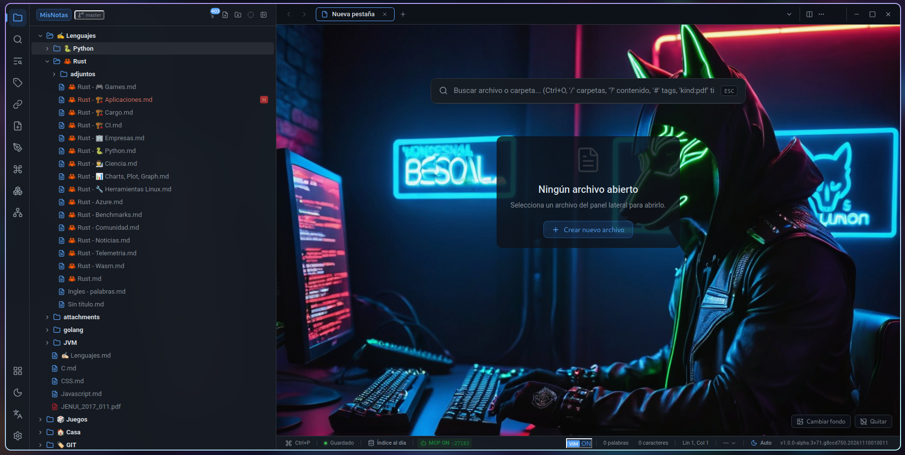

---

## 💡 ¿Qué es Synapse?

Synapse es un espacio de trabajo **todo en uno (baterías incluidas)** para pensar, escribir notas, leer documentos técnicos y modelar arquitecturas de software sin intermediarios ni dependencias en la nube. Está pensado especialmente para **desarrolladores, arquitectos y equipos técnicos**: la arquitectura se escribe como código (D2, Mermaid, PlantUML, Excalidraw, draw.io, BPMN, ArchiMate, OpenAPI y ADR en Markdown), vive en Git junto al proyecto y **tus agentes de IA la entienden, la recorren y la editan contigo**.

La mayoría de herramientas modernas sufren del mismo problema: consumen cientos de megabytes de RAM por usar Electron, dependen de docenas de plugins frágiles o encierran tus datos tras formatos propietarios y suscripciones en la nube. Synapse parte de una premisa simple: **tus archivos son tuyos, todo viene integrado de serie y la herramienta debe ser inmediata.**

Combina un backend en **Rust** (con Arquitectura Cebolla) y una interfaz en **Svelte 5** (Feature-Sliced Design). Arranca en milisegundos, consume una fracción mínima de memoria y está preparado desde el núcleo para el ecosistema de agentes mediante **ACP**, **MCP** y **OKF (Open Knowledge Format)**.

---

## 🚀 Primeros pasos

1. **Descarga** el paquete de tu sistema de la [última release](https://github.com/Miuler/synapse.rs/releases/latest): Linux (x86_64), Windows (x86_64) o macOS (Apple Silicon).
2. **Verifica** la descarga, como explica [SECURITY.md](SECURITY.md).
3. **Descomprime** y ejecuta `synapsers` (`synapsers.exe` en Windows). En macOS, abre la aplicación.
4. **Abre una bóveda:** en la pantalla de bienvenida, elige la carpeta donde están o estarán tus notas. Synapse pide confirmación y crea en ella una carpeta `.synapse/`; tus archivos siguen siendo archivos normales.
5. **Crea una nota** desde la paleta de comandos (`Ctrl+P` → «Crear nuevo archivo Markdown») y busca con `Ctrl+O`. Con `F1` ves todos los atajos.

Línea de comandos, formatos, configuración y servidor MCP: [referencia de la interfaz](docs/reference.md) (en inglés).

---

## ⚡ Capacidades Principales

### 1. 🏎️ Arquitectura Ligera y Rendimiento
- **Arranque optimizado:** Montaje de pestañas bajo demanda, árbol del explorador virtualizado y comandos de lectura asíncronos fuera del hilo principal de interfaz.
- **Gestión eficiente de memoria:** Basado en Tauri v2 en vez de empaquetar un navegador Chromium completo por ventana. Tras abrir y recorrer vaults grandes, el backend libera la memoria del heap devuelta al sistema operativo (`malloc_trim`).
- **Indexación nativa en paralelo:** Indexa decenas de miles de archivos usando hilos nativos (`rayon` + `jwalk`) sin congelar la interfaz ni bloquear el editor.

### 2. 🛡️ Soberanía de Datos (Local-first)
- **Tus archivos se quedan en tu disco:** Las notas son archivos estándar (`.md`, `.excalidraw.md`, `.d2`, `.puml`, `.mmd`). Sin bases de datos opacas ni sincronizaciones obligatorias.
- **Funciona offline:** Notas, Markdown, Mermaid, D2, Excalidraw, ArchiMate, búsqueda, Git y el servidor MCP no necesitan internet ni cuentas de terceros.
- **Cero telemetría:** Synapse no envía estadísticas de uso ni tiene cuentas propias.
- **Lo que sí usa la red, y cuándo:** unas pocas funciones dependen de servicios externos, siempre porque tú las usas. Están en [Qué sale de tu equipo](#-qué-sale-de-tu-equipo).

### 3. 🔍 Búsqueda Rápida e Indexación Profunda
- **Quick Open (`Ctrl+O`):** Búsqueda difusa en memoria mediante Nucleo Matcher (< 2 ms de respuesta).
- **Filtros por categoría (`kind:`):** Acota búsquedas por tipo de recurso: `kind:pdf`, `kind:markdown`, `kind:d2`, `kind:mermaid`, `kind:excalidraw`, `kind:bpmn`, `kind:word`, `kind:excel` o `kind:code`.
- **Filtro de encabezados (`hs:` / `headings:`):** Busca secciones y subtítulos directamente desde `Ctrl+O` o la búsqueda global (`Ctrl+Shift+F`), mostrando el título indexado y el texto inmediato.
- **Búsqueda Full-Text (Tantivy):** Motor de texto completo en Rust estilo Lucene que entiende identificadores (`camelCase`, `snake_case`, `kebab-case`) y busca dentro de `.pdf`, Word (`.docx`), hojas de cálculo (por hojas y filas), XML/BPMN/ArchiMate (sin ruido de coordenadas) y rutas de claves YAML/JSON.

### 4. 🔋 Baterías Incluidas: Notas, Tablas, Documentos y Diagramas
Todo viene integrado de serie, sin instalar plugins para trabajar con documentación técnica real:
- **Markdown fluido y tablas mejoradas:** Editor híbrido (CodeMirror 6), alternancia rápida lectura/edición (`F2`), enlaces a encabezados (`[[nota#Título]]`) y transclusión (`![[nota#Título]]`). Las **tablas en modo En vivo** se mantienen como texto real del documento con columnas alineadas al ancho real del texto, navegación fila por fila (`↑`/`↓`) sin desfasar líneas y editor visual bajo demanda. Además, atajo `Ctrl+Enter` para tareas y copia de listas como `☐` / `✅` para correo o Teams.
- **Todos los diagramas de arquitectura integrados:**
  - **D2 Lang** (motores ELK/TALA), **Mermaid & Merman** (con puntero láser) y **PlantUML** (`.puml`, `.plantuml`).
  - **Excalidraw** (`.excalidraw.md`) y **draw.io** (`.drawio`, `.drawio.png`, `.drawio.svg`).
  - **BPMN** (`.bpmn`, indexado por pasos y anotaciones) y modelos **ArchiMate** (`.archimate`).
  - Exportación de diagramas a **PNG** o **SVG** y render optimizado con monitor en la barra de estado.
- **Visor OpenAPI / Swagger (Scalar) + Editor YAML/JSON:** Los archivos `openapi` / `swagger` se abren en Lectura como documentación interactiva embebida (sin CDN, sin «Ask AI» ni telemetría), siguen `$ref` entre archivos de la bóveda (también en historial Git) y adoptan el tema activo. En Edición incluyen resaltado YAML/JSON, navegación de `$ref` e índice de claves (`Ctrl+F12`).
- **Lectores rápidos de Word y Excel / Hojas de cálculo:**
  - **Word (`.docx`, `.docm`, `.dotx`):** Visor nativo de solo lectura con páginas, tablas, imágenes, encabezados y zoom proporcional de página completa (`50 %–300 %`) con «Ajustar al ancho».
  - **Hojas de cálculo (`.xlsx`, `.xlsm`, `.xltx`, `.xltm`, `.xls`, `.xlsb`, `.ods`):** Visor virtualizado ultrarrápido que pinta solo las filas/columnas visibles y carga libros grandes por tramos, con estilos, celdas combinadas, barra de fórmulas, vista de fórmulas (`Ctrl+\``), pestañas de hojas y zoom proporcional.

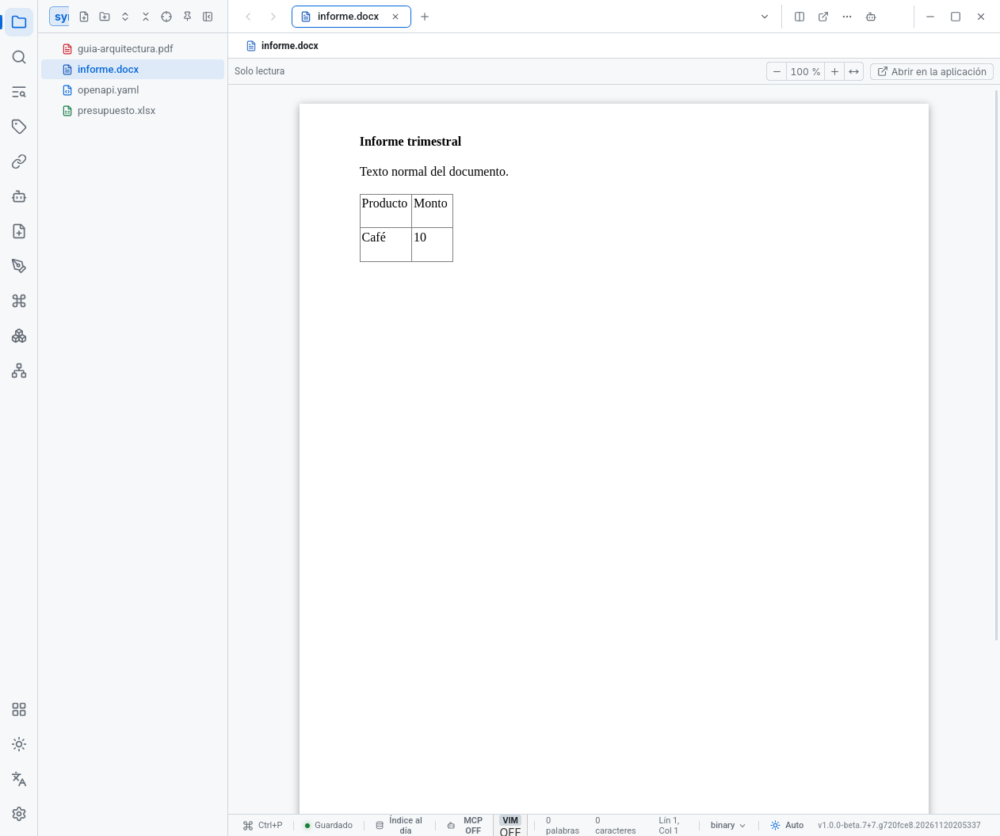

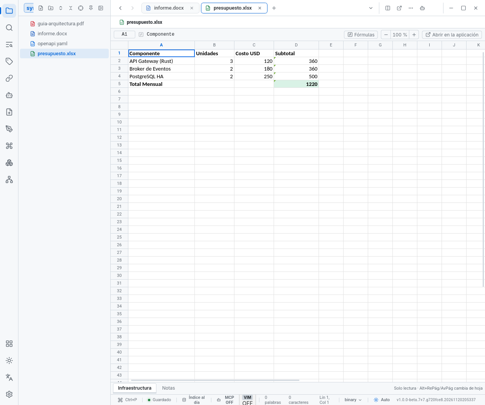

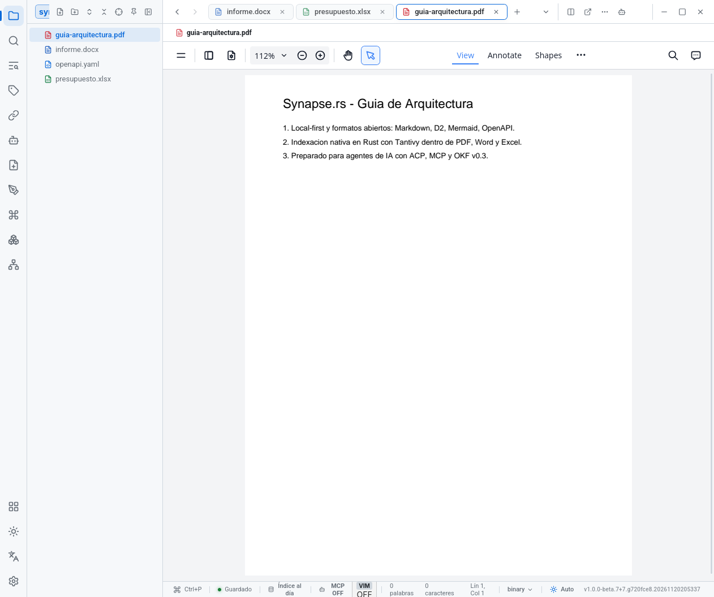

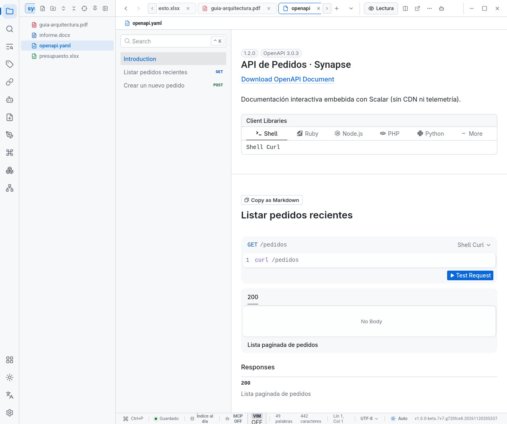

### 5. 🐙 Control de Versiones Git y Comparación Visual (Diff Multi-Modal)
- **Git multi-repositorio + Git Log estilo JetBrains:** Varios repositorios Git en la misma bóveda, diálogo de **Git Log de todas las ramas** con grafo en colores, tags, checkout, **fast-forward** (`↓N / ↑N`) sin commits extra, vista en árbol en commits y push con `Ctrl+Shift+K`.
- **Comparación entre archivos arbitrarios:** Selecciona dos archivos cualesquiera en el explorador y compáralos al instante (incluso entre tipos distintos, como Mermaid vs Excalidraw o `.drawio` vs `.drawio`).
- **Diff de imágenes binarias:**
  - *2 Paneles:* Vista lado a lado (antes a la izquierda, después a la derecha) con zoom independiente.
  - *Píxel a Píxel:* Resaltado visual en magenta de cada píxel alterado con porcentaje y conteo exacto de diferencias.
- **Diff multi-modo para diagramas (Excalidraw, D2, Mermaid, PlantUML, draw.io):**
  - *Como Diagrama:* Visualiza ambos estados en paralelo con edición local sobre la marcha.
  - *Píxel a Píxel:* Renderiza ambas versiones a imagen para localizar de inmediato cualquier trazo, caja o texto modificado.
  - *Como Texto:* Inspecciona diferencias línea por línea en el código fuente o estructura JSON/XML (colapsado a los cambios por defecto).

### 6. 🤖 Preparado para Agentes: Estándares Abiertos (OKF + MCP)
Synapse está diseñado desde la base para que los agentes de IA trabajen con tu conocimiento usando estándares abiertos:
- **Índice OKF (Open Knowledge Format v0.3):** Synapse mantiene automáticamente un `index.md` en cada carpeta con subcarpetas, conceptos (`type` + `description`) y demás archivos (con `okf_version: "0.3"` en la raíz). Pensado para commitearse en Git y para que **cualquier agente recorra la bóveda desde el disco sin perderse ni quemar tokens**.
- **Servidor MCP integrado (Model Context Protocol):** Conecta Claude Code, Google Antigravity, Cursor, Windsurf o Roo Code a tu vault local. `read_note` devuelve el `index.md` de la raíz y de la carpeta de la nota.
- **Herramientas especializadas de arquitectura:** `render_diagram` (el agente ve tus diagramas e imágenes renderizadas), `extract_note_diagrams` (estructura de contenedores y conexiones en draw.io), `inspect_archimate_element` (consultas en ~0,3 ms con caché), historial Git y resolución de enlaces ambiguos.
- **Concurrencia Optimista (OCC) y ahorro de tokens:** Escrituras seguras mediante `expected_hash`, búsqueda jerárquica por tags (`#linux/cachyos`), esquema de títulos (`outline_only: true`) y lectura quirúrgica por secciones (`section`).

### 7. ⌨️ Flujo de Trabajo y Teclado
- **Modo Vim:** Activación instantánea con soporte de comandos, búsqueda (`/`), rehacer (`Ctrl+R`) y plegado por niveles (`zc`, `zo`, `za`, `zM`, `zR`).
- **Autocompletado del documento:** Sugerencias automáticas basadas en palabras ya escritas en la nota o diagrama activo.
- **Zoom de texto:** Ajuste rápido de tamaño con `Ctrl+Rueda`, `Ctrl++`, `Ctrl+-` y `Ctrl+0`.
- **Atajos configurables:** Personalización de combinaciones mediante `shortcuts.jsonc` (conservando comentarios).
- **Modo Archivo Único:** Abre y edita archivos individuales `.md`, `.d2` o `.excalidraw` sin necesidad de crear un workspace.
- **Plugins de Obsidian:** Compatibilidad con extensiones comunitarias verificadas a través de una fachada de su API.

### 8. 🎨 Temas por Defecto
Synapse incluye temas integrados listos para usar con variantes clara y oscura. Con `` Ctrl+` `` eliges uno de la lista sin entrar a Configuración:

#### Neón
Inspiración cyberpunk con acentos luminosos sobre fondo oscuro:

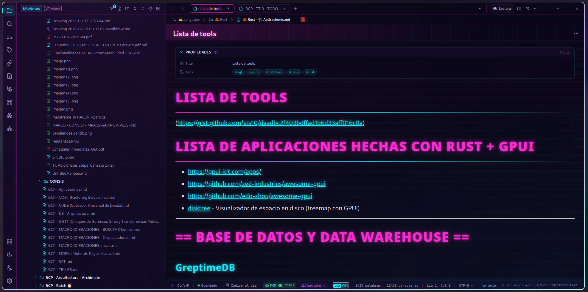

#### Neón Islas
Variante con paneles flotantes y esquinas redondeadas:

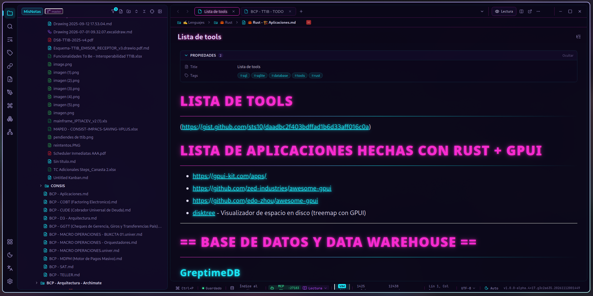

#### Rosa
Tonos frambuesa en modo claro y ciruela suave en modo oscuro:

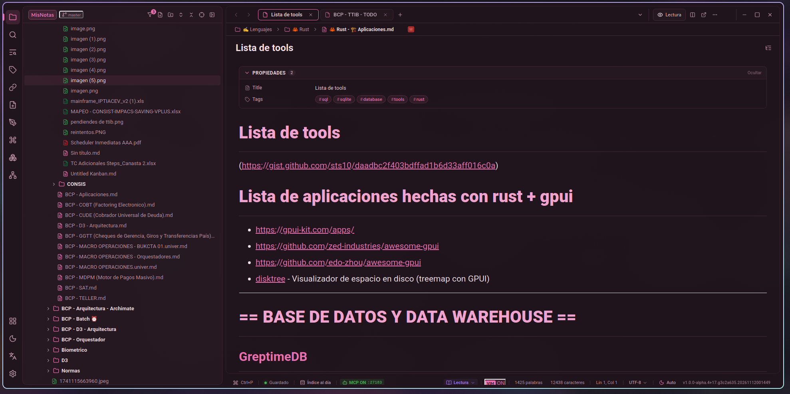

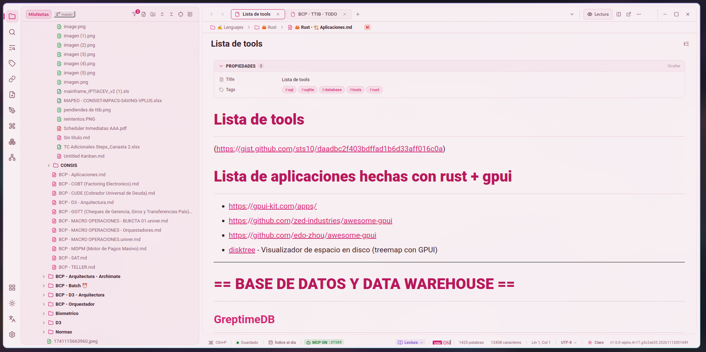

### 9. 🏗️ Arquitectura como Código (para desarrolladores)
La documentación de arquitectura son archivos de texto versionables, no imágenes pegadas que nadie actualiza:

- **Diagramas declarativos con vista previa en vivo:** edita el código D2 (motores ELK/TALA), Mermaid o PlantUML a la izquierda y mira el diagrama a la derecha, con zoom, puntero láser y exportación a PNG/SVG.
- **Decisiones (ADR) como notas:** Markdown con propiedades (`estado`, `tags` jerárquicos como `#arquitectura/adr`), enlaces a secciones exactas (`[[adr-0001#Decisión]]`) y transclusión (`![[adr-0001#Decisión]]`) para reutilizar una decisión en otra.
- **Todo en el repositorio:** diagramas, ADR y código viven juntos; con el Git integrado, el historial y el diff visual ves **cómo evolucionó la arquitectura** commit a commit.
- **Buscable:** `kind:d2`, `kind:mermaid` y `hs:` encuentran un contenedor, una decisión o un encabezado entre miles de archivos.

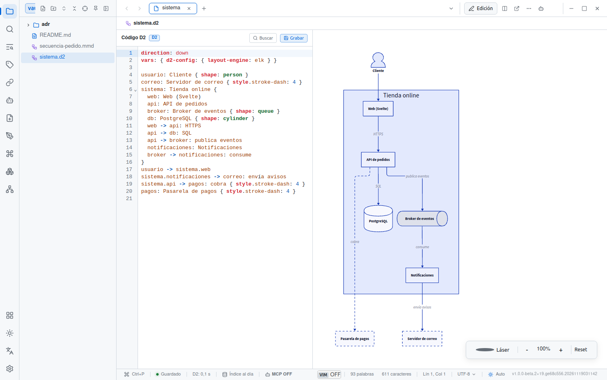

Diagramas de secuencia con Mermaid, como parte de la misma bóveda:

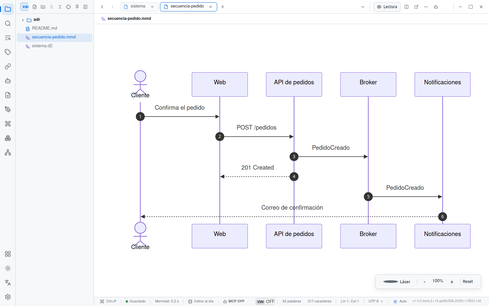

Los ADR enlazan con los diagramas y reutilizan secciones de otras decisiones por transclusión:

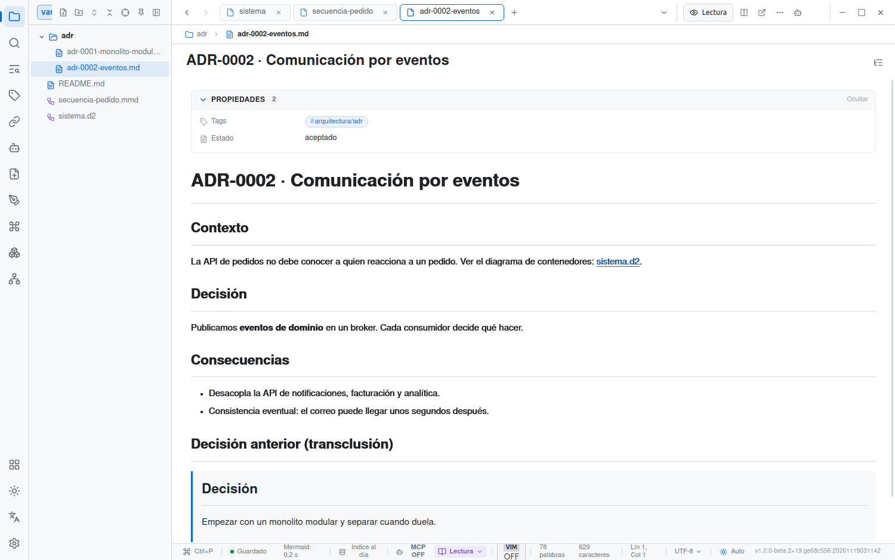

### 10. 🧠 Agentes de IA integrados (ACP)
Un panel lateral (`Alt+2`, fijable o flotante sobre el editor) para conversar con agentes de IA **sobre tu bóveda**, sin salir de Synapse:

- **Agentes compatibles con ACP (Agent Client Protocol):** Claude (descarga verificada con sha256 desde el registro público de ACP), Google Antigravity y **GitHub Copilot** (`copilot --acp`); además puedes registrar cualquier agente propio (comando, argumentos y variables de entorno) en *Ajustes → Agentes de IA*.
- **Trabajan con tus archivos mediante MCP + OKF:** cada sesión recibe la bóveda abierta como `synapse_instance`. El agente recorre los índices OKF, busca, lee por secciones, edita con control optimista (`expected_hash`) y puede **ver los diagramas dibujados** (`render_diagram`), inspeccionar modelos ArchiMate o leer el historial Git.
- **Conversación rica y cola de mensajes:** respuestas en streaming y Markdown (con casillas de tarea copiables como `☐` / `✅`), cola automática de mensajes mientras el agente trabaja, caja de texto autoajustable, zoom propio, imágenes en pestaña dedicada con «Guardar en la bóveda» y **peticiones de permiso** con un clic.
- **Contexto a tu medida:** adjunta notas con `@`, la nota abierta con `@this`, la selección del editor con `Ctrl+Alt+A`, imágenes pegadas con `Ctrl+V` y comandos del agente con `/` (`/compact`, `/usage`…). Con `/btw` preguntas algo aparte sin interrumpir al agente y con `/fork` abres otra conversación con el mismo contexto.
- **Varias conversaciones a la vez** en acordeón, con historial guardado en la bóveda (`.synapse/agent-sessions/`), que se retoma con el agente y el contexto originales.
- **Los agentes se hablan entre sí 🐙:** entre conversaciones (`#2`) y **entre bóvedas abiertas en otras ventanas** (`@Bóveda#`). Un agente puede consultar la documentación de otra bóveda (solo lectura, con tu permiso) — por ejemplo, validar tus diagramas contra la arquitectura de otro sistema.
- **Control total:** lecturas permitidas, escrituras con confirmación y aviso de atención cuando el agente espera tu respuesta.

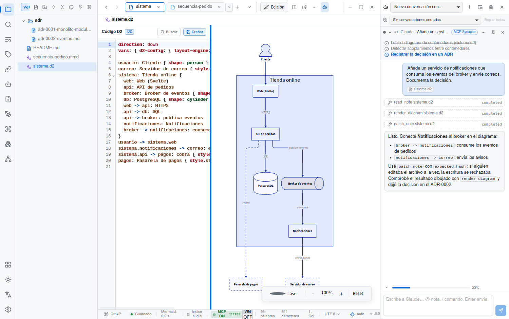

> *Ejemplo real de la interfaz: el agente lee el diagrama, lo comprueba dibujado, lo edita con `patch_note` y deja la decisión en el ADR.*

---

## 📊 Comparativa

| Aspecto | **Synapse.rs** 🧠 | **Obsidian** 💎 | **Notion** ☁️ | **VS Code** 💻 |
| :--- | :---: | :---: | :---: | :---: |
| **Arquitectura de ejecución** | **Rust + Tauri v2 (Webview nativo)** | Electron (Chromium empaquetado) | Web / Electron | Electron (Chromium empaquetado) |
| **Soberanía de archivos** | **100% Local / Formatos abiertos** | 100% Local | En la nube (Propietario) | 100% Local |
| **Búsqueda en PDFs / DOCX / Excel / XML** | **Nativa en Rust (Tantivy)** | Requiere Plugins | En la nube | Requiere extensiones |
| **Visores nativos (Word, Excel, OpenAPI)** | **Integrados de serie (Scalar + virtualización)** | Plugins / App externa | En la nube / Básico | Extensiones |
| **Filtros (`kind:`, `hs:`)** | **Nativos en Quick Open y FTS** | Plugins de terceros | No | Extensiones |
| **Diagramas D2, Mermaid, PlantUML, BPMN, ArchiMate** | **Nativos + draw.io y exportación PNG/SVG** | Plugins de terceros | Básico | Extensiones |
| **Lienzo Excalidraw** | **Nativo (.excalidraw.md)** | Vía plugin | No | Extensiones |
| **Control de versiones Git** | **Multi-repo + Git Log visual (`gix` + Git)** | Requiere Git CLI | No | Requiere Git CLI |
| **Diff visual de diagramas e imágenes** | **Nativo (Lado a lado, Píxel a píxel)** | No | No | Extensiones |
| **Estándares para IA (MCP + OKF)** | **MCP nativo (OCC, diagramas, ArchiMate) + índices OKF** | Plugins de terceros | No | Extensiones |
| **Agentes de IA (ACP) en la app** | **Panel integrado (Claude, Antigravity, Copilot), cola y permisos** | Plugins de terceros | Asistente propietario en la nube | Extensiones |
| **Arquitectura como código** | **D2 + Mermaid + PlantUML + ADR, con vista previa y Git** | Plugins | No | Extensiones |
| **Portabilidad** | **Binario único sin instalación** | Instalador / AppImage | Instalador | Instalador |

---

## 🔍 Comparación Visual en Acción

### Diff de Imágenes (Lado a Lado vs. Píxel a Píxel)

Panel a panel con controles de encuadre y zoom:

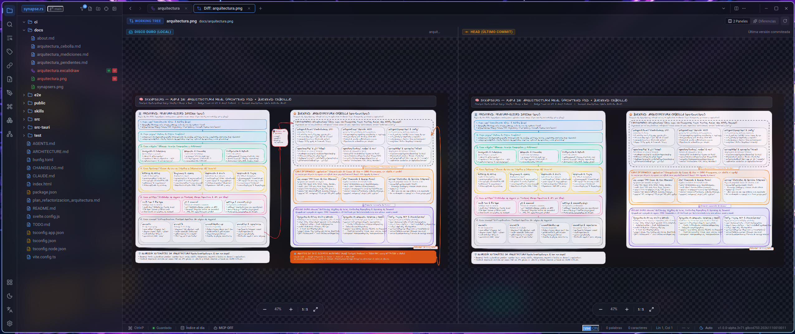

Detección automática de cambios resaltando los píxeles modificados en magenta:

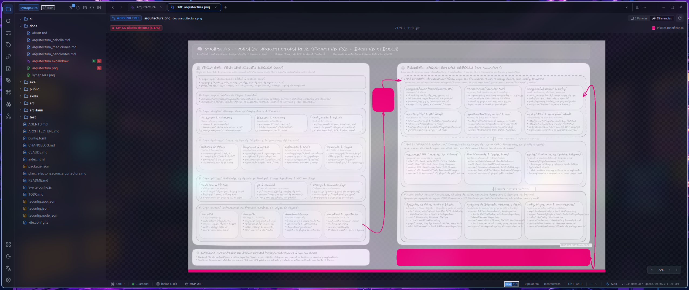

---

### Diff de Diagramas (Como Diagrama vs. Píxel a Píxel vs. Como Texto)

Comparación visual interactiva en dos paneles con modo de edición local:

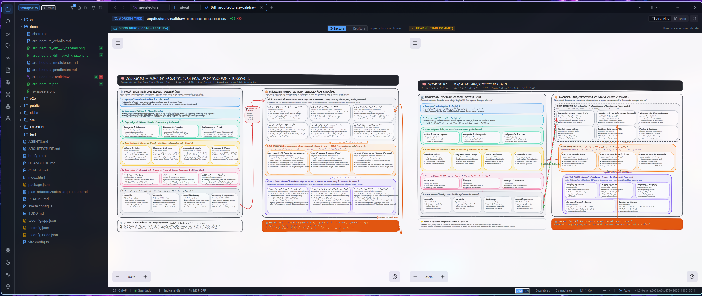

Renderizado temporal a imagen binaria para ubicar fácilmente cualquier cambio gráfico mediante resaltado píxel a píxel:

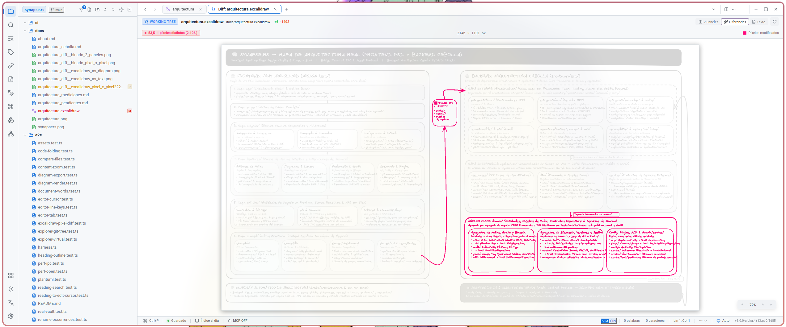

Vista de código para auditar cambios a nivel de texto o estructura JSON:

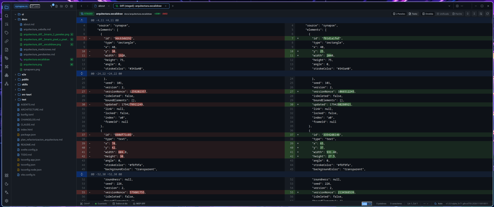

---

## 🏛️ Arquitectura Técnica

Synapse sigue una estricta separación de responsabilidades para garantizar mantenibilidad, velocidad y estabilidad a largo plazo:

- **Frontend (Svelte 5 + Bun):** Diseñado con **Feature-Sliced Design (FSD)** en capas unidireccionales (`app` ➔ `pages` ➔ `widgets` ➔ `features` ➔ `entities` ➔ `shared`).
- **Backend (Rust + Tauri v2):** Construido con **Arquitectura Cebolla**. El núcleo (`domain/`) no contiene frameworks ni I/O; la capa de orquestación (`application/`) contiene 48 casos de uso atómicos, y los adaptadores técnicos (`infrastructure/`) implementan los contratos (persistencia en disco, Tantivy, Nucleo, Gix, servidor MCP).

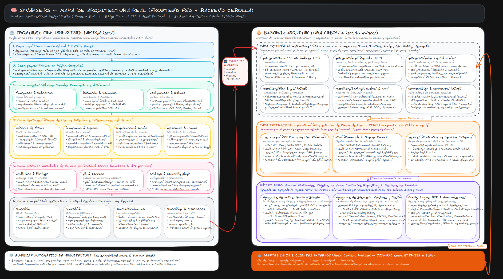

---

## 🔌 Qué sale de tu equipo

Synapse es local-first, no «100 % local»: unas pocas funciones necesitan un servicio externo. Todas dependen de que uses esa función, salvo la búsqueda de actualizaciones al iniciar, que se puede desactivar.

| Función | Con qué se conecta | Qué viaja |
|---|---|---|
| **Editor de draw.io** | `embed.diagrams.net` (configurable: puedes usar tu propio draw.io) | El editor se descarga de esa web y corre dentro de Synapse. El diagrama se le pasa dentro de la app, pero es código de un tercero el que lo maneja. Sin conexión no se puede editar (los `.drawio.png`/`.svg` sí se ven). |
| **Vista previa de PlantUML** | `www.plantuml.com` (configurable: puedes usar un servidor propio, p. ej. en Docker) | **El texto del diagrama se envía** a ese servidor para dibujarlo. |
| **Agentes de IA (ACP)**: Claude, GitHub Copilot, Antigravity… | El proveedor de cada agente, con tu propia cuenta | **Tus mensajes y lo que el agente lea de la bóveda** van a ese proveedor, según sus condiciones. Synapse solo los lanza y les da acceso a la bóveda. La lista de agentes verificados se consulta en `cdn.agentclientprotocol.com` y el agente se descarga de su sitio oficial al instalarlo. |
| **Plugins de la comunidad** | GitHub (catálogo de Obsidian y el repositorio de cada plugin) | Solo al abrir el catálogo o instalar o actualizar un plugin. |
| **Git** (`push`, `clone`) | El remoto que tú configures | Tu repositorio, cuando tú lo envías o clonas. |
| **Actualizaciones** | GitHub (`latest.json` de la última release) | Al iniciar (desactivable en *Ajustes → Actualizaciones*) o con «Buscar actualizaciones»: solo la petición, sin datos de tus notas. Si aceptas actualizar, se descarga el paquete y se verifica su firma antes de instalarlo. |
| **Servidor MCP** | Solo `localhost` | Nada sale del equipo: es para tus agentes locales. |

Si trabajas con información sensible, configura un draw.io y un servidor PlantUML propios, y elige los agentes de IA teniendo en cuenta a qué proveedor envían los datos.

---

## 🔒 Seguridad y privacidad

Lo que la tabla anterior no cuenta y conviene saber (revisado en el código de `src/` y `src-tauri/src/`; las librerías de terceros incluidas no se han auditado una a una):

- **Servidor MCP:** escucha solo en `127.0.0.1`, pero el endpoint `/mcp` no pide autenticación y responde con `Access-Control-Allow-Origin: *`. Mientras esté encendido, cualquier proceso local —o una página web abierta en tu navegador— puede enviarle peticiones. Apágalo si no lo usas.
- **Plugins de la comunidad:** `manifest.json`, `main.js` y `styles.css` se descargan de la rama por defecto del repositorio del plugin **sin verificar ningún hash**, y `main.js` se ejecuta dentro de la app. Instala solo plugins que hayas revisado.
- **Agentes ACP:** los binarios se comprueban contra el `sha256` del registro cuando este lo incluye.
- **YouTube:** si una nota enlaza un vídeo, se pide su miniatura a `img.youtube.com`.
- **Recursos remotos:** el CSP del WebView está desactivado (`csp: null`), así que Synapse no bloquea que una nota cargue contenido de la red.
- **Acceso a archivos:** la interfaz solo lee y escribe en la bóveda abierta y en los archivos que eliges. Un archivo suelto muestra además las imágenes de su carpeta y subcarpetas.
- **Actualizaciones:** al iniciar, Synapse consulta el `latest.json` de la última release (desactivable en *Ajustes → Actualizaciones*) y avisa si hay una versión nueva. Solo se instala si lo aceptas, y el paquete se verifica con la firma minisign y la clave pública de `tauri.conf.json` antes de reemplazar el ejecutable.
- **Telemetría:** no se encontró código de telemetría ni informes de errores. Los visores embebidos que la ofrecen la tienen apagada (Scalar con `telemetry: false`, el visor de PDF sin CDN). Los plugins comunitarios y los agentes son código de terceros.

Cada release incluye `SHA256SUMS.txt`, el SBOM (CycloneDX) y una attestation de procedencia firmada con Sigstore: cómo verificarlos y cómo reportar una vulnerabilidad está en [SECURITY.md](SECURITY.md).

---

## 📦 Distribución

- **Binario portable:** Un único archivo ejecutable (`synapsers` en Linux / `synapsers.exe` en Windows).
- **Sin instaladores obligatorios:** No requiere dependencias del sistema ni permisos administrativos para ejecutarse.

---

## 💬 Errores, ideas y contribuciones

- **Errores e ideas:** abre una [incidencia en GitHub](https://github.com/Miuler/synapse.rs/issues), en español o en inglés.
- **Vulnerabilidades:** de forma privada, como indica [SECURITY.md](SECURITY.md).
- **Código:** por ahora no se aceptan *pull requests*; el motivo está en [CONTRIBUTING.md](CONTRIBUTING.md).

---

## 🛠️ Desarrollo

Arquitectura del código, requisitos y cómo compilar: [CONTRIBUTING.md](CONTRIBUTING.md).

---

## ⚖️ Licencia

Copyright © 2026 Hector Miuler Malpica Gallegos.

Synapse.rs es software libre bajo la [GNU GPL 3.0 o posterior](LICENSE) (`GPL-3.0-or-later`): puedes usarlo, estudiarlo, modificarlo y compartirlo, también en tu empresa. Si distribuyes una versión modificada, debes publicar su código con la misma licencia. Se ofrece **sin ninguna garantía**. Tus notas y documentos son tuyos: la licencia no los afecta.

- **Servidor:** la carpeta `synapse-server/` es solo una **prueba de concepto**, no un producto ni un servicio disponible, y **no** está cubierta por esta licencia; todos los derechos reservados.
- **Nombre y logotipos:** la licencia del código no concede derechos sobre el nombre «Synapse.rs», su logotipo ni el pulpo. Un fork debe usar otro nombre y otra imagen.
- **Terceros:** las dependencias conservan sus propias licencias.
- **Contribuciones:** por ahora no se aceptan *pull requests* de código; consulta [CONTRIBUTING.md](CONTRIBUTING.md).
