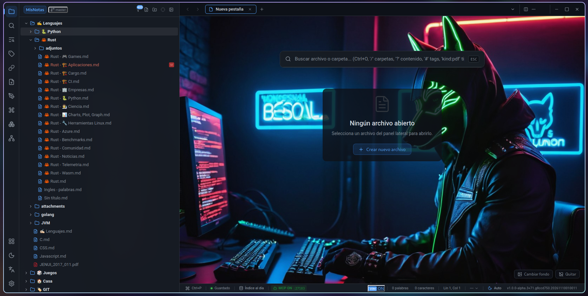
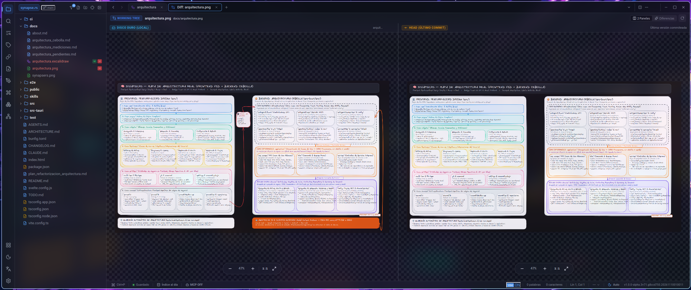
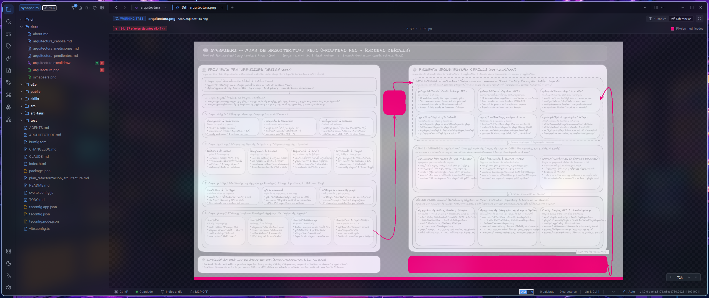
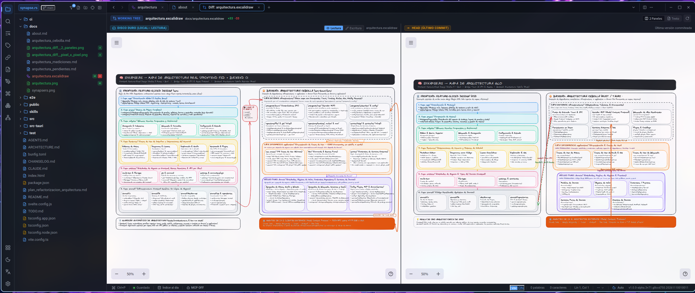
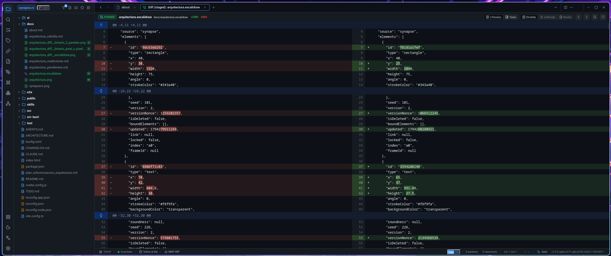
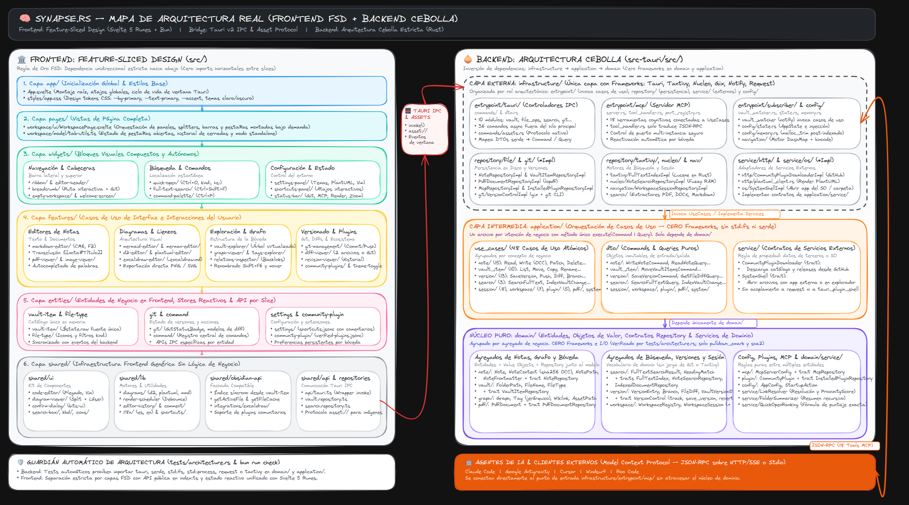

# Synapse.rs 🧠⚡

> **Tu segundo cerebro a la velocidad de la luz.**  
> Gestión de conocimiento personal, notas y arquitectura visual desarrollada en **Rust (Tauri v2)** y **Svelte 5**.  
> *100% Local-First. Zero-Telemetry. Rendimiento Nativo.*

---

---

## 🌟 La Visión: Redefiniendo el Conocimiento Personal

En un mundo saturado de herramientas lentas basadas en Electron o plataformas en la nube que encierran tus ideas tras suscripciones mensuales y muros de datos (*vendor lock-in*), **Synapse** nace como una declaración de principios:

> **Tus pensamientos merecen la velocidad del metal y la soberanía absoluta de tus archivos.**

Synapse combina la potencia, seguridad de memoria y velocidad extrema de **Rust** con la reactividad pura y elegancia de **Svelte 5 (Runes)**. El resultado es un entorno de trabajo cognitivo donde la fricción desaparece: abre vaults masivos en milisegundos, dibuja conceptos complejos al instante y localiza cualquier pensamiento en tus notas, diagramas, libros PDF o documentos Word a la velocidad del pensamiento.

---

## 🚀 ¿Por qué Synapse? Argumentos de Venta y Propuesta de Valor

### 1. 🏎️ Rendimiento Descomunal: Adiós al "Bloatware"
- **Inicio en milisegundos:** Pestañas montadas bajo demanda, explorador de archivos virtualizado y comandos de lectura desacoplados del hilo principal.
- **Consumo mínimo de RAM:** Construido sobre **Tauri v2** en lugar de empaquetar un navegador Chromium completo por ventana. Synapse libera proactivamente la memoria al sistema tras la apertura del vault, consumiendo una fracción mínima en comparación con Obsidian, Notion o Logseq.
- **Motor de indexación en Rust:** Indexación paralela con hilos nativos (`rayon` + `jwalk`), procesando decenas de miles de archivos en segundos sin congelar la interfaz.

### 2. 🛡️ Soberanía de Datos y Privacidad Radical (Local-First)
- **Tus archivos son tuyos:** Notas y diagramas en formatos abiertos estándar (Markdown, Mermaid, D2, PlantUML, Excalidraw, imágenes). Sin formatos propietarios ni bases de datos cerradas.
- **100% Offline:** Funciona en un avión, en la montaña o en redes aisladas sin requerir conexión a internet ni cuentas externas.
- **Cero Telemetría:** Nadie escanea ni monetiza tus pensamientos, diagramas o notas.

### 3. 🔍 Búsqueda Cognitiva de Nivel Industrial (Tantivy + Nucleo)
- **Quick Open inteligente (`Ctrl+O`):** Búsqueda difusa en memoria ultrarrápida con Nucleo Matcher (< 2 ms).
- **Filtros por tipo de archivo (`kind:`):** Encuentra al vuelo lo que buscas filtrando por extensión o categoría: `kind:pdf`, `kind:markdown`, `kind:word`, `kind:excel`, `kind:mermaid`, `kind:d2`, `kind:excalidraw` o `kind:code`.
- **Búsqueda directa en encabezados (`hs:` o `headings:`):** Localiza secciones y subtítulos específicos directamente desde `Ctrl+O` o la búsqueda global (`Ctrl+Shift+F`), mostrando el título indexado y el contexto inmediato.
- **Motor Full-Text estilo Lucene en Rust (Tantivy):** Ponderación inteligente de títulos, búsqueda por prefijos y frases sin degradación de velocidad.
- **Indexación de adjuntos (PDFs y Word DOCX):** Extrae e indexa de forma nativa el texto de libros, papers (`.pdf`) y documentos (`.docx`), convirtiendo tu vault en una biblioteca viva.

### 4. 🎨 Suite de Pensamiento Visual y Diagramas como Código
- **Markdown Enriquecido y Modular:** Soporte CodeMirror 6, renderizado dinámico en modo lectura, enlaces profundos a encabezados (`[[nota#Título]]`) e incrustación de secciones completas con transclusión recursiva (`![[nota#Título]]`).
- **Tríada de Diagramación como Código (Mermaid, D2 y PlantUML):**
  - **Mermaid & Merman:** Diagramas de flujo y secuencias con puntero láser interactivo para presentaciones de arquitectura en vivo.
  - **D2 Lang:** Sintaxis declarativa moderna para diagramas de arquitectura técnica y flujos complejos.
  - **PlantUML (`.puml`, `.plantuml`):** Soporte completo para diagramas UML con servidor configurable, autocompletado y validación de sintaxis en línea.
  - **Render reactivo optimizado:** Planificador con debounce dinámico, `Ctrl+Enter` para forzar redibujado y monitor de estado del render en la barra de estado.
  - **Exportación en un clic:** Exporta diagramas Mermaid, D2 y Excalidraw a gráficos vectoriales **SVG** o imágenes de alta resolución **PNG** directamente desde el menú contextual.
- **Lienzos Infinitos con Excalidraw:** Mapas mentales, bocetos y wireframes interactivos embebidos directamente en notas (`.excalidraw.md`).

### 5. 🐙 Git Nativo en Puro Rust y Suite de Comparación Visual (Multi-Modal Diff)
- **Control de versiones nativo con `gix`:** Historial de revisiones, commits, branching, stage/unstage y sincronización remota (`Ctrl+Shift+K`) sin depender de herramientas externas.
- **Comparación de Imágenes Binarias (2 Paneles vs. Píxel a Píxel):**
  - **Diff Binario Panel a Panel (`2 Paneles`):** Compara lado a lado la imagen local en disco frente a la revisión en Git (`HEAD`, `Stage` o commit histórico), con controles independientes de zoom y encuadre.
  - **Diff Binario Píxel a Píxel (`Diferencias`):** Superposición algorítmica de alta precisión que resalta en magenta cada píxel modificado y calcula el conteo exacto y porcentaje de variación visual (ej. `139,137 píxeles distintos (5.47%)`).
- **Comparación Dual para Diagramas como Excalidraw, Mermaid, D2 y PlantUML (Como Diagrama vs. Como Texto):**
  - **Diff como Diagrama (`2 Paneles` interactivos):** Renderiza el lienzo visual en ambos paneles (Disco Duro vs. Git). El panel local permite conmutar al vuelo entre **modo `Lectura` y modo `Escritura`** para corregir el diagrama en vivo mientras observas la versión anterior.
  - **Diff como Texto (`Texto` — Dividida, Unificada o Parche):** Inspecciona las diferencias exactas a nivel de código fuente o estructura JSON/Markdown con resaltado de sintaxis línea por línea y carácter por carácter.
- **Diff entre archivos arbitrarios del explorador:** Selecciona dos archivos cualesquiera con `Ctrl+Clic` en el explorador de la bóveda y compáralos al instante sin necesidad de que estén en Git.

### 6. 🤖 Servidor MCP Integrado de Alto Rendimiento (Model Context Protocol)
- **Tu conocimiento al servicio de la IA:** Conecta asistentes y agentes de IA (Claude Code, Google Antigravity, Cursor, Windsurf, Roo Code, etc.) directamente a tu bóveda personal mediante un servidor MCP nativo de alto rendimiento.
- **Concurrencia Optimista (OCC) y Edición Segura:** `write_note` y `patch_note` exigen `expected_hash` u `overwrite: true` explícito, impidiendo que agentes de IA sobrescriban o pisen notas inadvertidamente.
- **Búsqueda Jerárquica por Sub-tags:** Filtra notas por etiquetas jerárquicas (`#linux/cachyos`), extrayendo snippets y estimaciones de tokens al vuelo.
- **Lectura Quirúrgica y Ahorro Masivo de Tokens:** Lectura ultrarrápida del índice de contenidos (`outline_only: true`) y extracción por sección individual (`section`), ahorrando hasta un 90% de contexto a los LLMs.
- **Persistencia inteligente de sesión:** El servidor MCP recuerda su activación por bóveda y se reactiva automáticamente entre sesiones de trabajo.

### 7. 🔌 Ecosistema Extensible: Plugins Comunitarios de Obsidian
- **Compatibilidad con plugins:** Explora, instala y ejecuta extensiones creadas para Obsidian mediante una fachada nativa compatible de su API.
- **Filtro "Solo compatibles":** Navega de forma segura por el catálogo destacando extensiones verificadas y testeadas rigurosamente.

### 8. ⌨️ Diseñado para la Máxima Ergonomía de Teclado
- **Modo VIM nativo:** Toggle instantáneo desde la barra de estado o atajo rápido, con soporte de comandos de navegación, búsqueda (`/`), rehacer (`Ctrl+R`) y plegado por niveles (`zc`, `zo`, `za`, `zM`, `zR`).
- **Autocompletado inteligente del documento:** Sugerencias basadas en palabras y símbolos ya escritos en la nota o diagrama actual.
- **Paleta de Comandos y Atajos Personalizables:** Configura cada acción en `shortcuts.jsonc` preservando comentarios y formato.
- **Zoom tipográfico interactivo:** Ajusta el tamaño de fuente al vuelo con `Ctrl + Rueda`, `Ctrl + +`, `Ctrl + -` y `Ctrl + 0`.
- **Modo Standalone:** Edita archivos individuales `.md`, `.d2`, `.puml` o `.excalidraw` sueltos en tu disco sin necesidad de abrir o crear un workspace.

---

## 📊 Tabla Comparativa: Synapse frente al Mercado

| Característica | **Synapse.rs** 🧠 | **Obsidian** 💎 | **Notion** ☁️ | **Logseq** 📝 | **VS Code** 💻 |
| :--- | :---: | :---: | :---: | :---: | :---: |
| **Tecnología Base** | **Rust + Tauri v2** | Electron | Electron / Web | Electron | Electron |
| **Consumo de Memoria** | **Ultra Bajo (~50-120 MB)** | Medio (~250-600 MB) | Muy Alto (~500 MB-1.5 GB) | Alto (~350-800 MB) | Alto (~400 MB-1 GB) |
| **Velocidad de Arranque** | **Instantánea (< 0.2s)** | 2 - 5s | Lenta (depende de red) | 3 - 6s | 2 - 4s |
| **Soberanía / Local-First** | **100% Local / Zero Lock-in** | Local-First | En la nube (Propietario) | Local-First | Local-First |
| **Búsqueda en PDFs y DOCX** | **Nativa en Rust (Tantivy)** | Requiere Plugins | Indexado en nube | Básico | Requiere Extensiones |
| **Filtros Avanzados (`kind:`, `hs:`)** | **Nativo en Quick Open & FTS** | Plugins de terceros | Búsqueda básica | Básico | Con extensiones |
| **Diagramas Mermaid Interactivos** | **Nativo + Puntero Láser** | Básico (estático) | Básico | Básico | Con extensiones |
| **Diagramas D2 y PlantUML** | **Nativo con autocompletado y exportación** | Vía Plugins | No | No | Vía Plugins |
| **Lienzo Excalidraw Integrado** | **Nativo (.excalidraw.md)** | Vía Plugin | No | Vía Plugin | Con extensiones |
| **Git Nativo Integrado** | **Puro Rust (`gix`)** | Requiere Git CLI | No | Vía Git local | Requiere Git CLI |
| **Diff de Imágenes Binarias** | **Nativo (2 Paneles + Píxel a Píxel %)** | No | No | No | Básico (sin conteo píxel) |
| **Diff de Diagramas (Excalidraw/D2/Mermaid)** | **Dual: Como Diagrama interactivo y Como Texto** | No (Solo texto plano) | No | No | Con extensiones |
| **Comparación de Archivos (Diff)** | **Nativa (2 archivos o Git)** | Vía Plugins | No | No | Nativa |
| **Servidor MCP Nativo (AI Ready)** | **Sí (OCC, Sub-tags, Outline & Snippets)** | Requiere Plugins de terceros | No | No | Vía extensiones |
| **Modo VIM al vuelo** | **Sí (Toggle instantáneo + Plegado)** | Sí (Configuración) | No | Experimental | Vía extensión |
| **Atajos personalizables (JSONC)** | **Sí (`shortcuts.jsonc`)** | Sí (GUI) | Limitado | Sí | Sí (`keybindings.json`) |
| **Modo Archivo Único (Standalone)** | **Sí (Abre archivos sueltos)** | No (Exige Vault) | No | No (Exige Grafo) | Sí |
| **Distribución Portable** | **Binario Único sin instalador** | Instalador/AppImage | Instalador | Instalador/AppImage | Instalador/Tarball |

---

## 🛠️ Características Detalladas

### 🗂️ 1. Navegación y Gestión de Espacios de Trabajo
- **Multipestaña inteligente y Pestaña Vacía con Quick Search:** Abre notas, diagramas, imágenes y documentos en pestañas paralelas con control de estado sucio (`*`). Las pestañas vacías ofrecen acceso inmediato al buscador `Ctrl+O` y personalización visual con fondo configurable.
- **Explorador Virtualizado:** Navega fluidamente por bóvedas con decenas de miles de archivos gracias al renderizado virtualizado de filas.
- **Navegación Fluida por Breadcrumbs:** Haz clic en cualquier nivel de la ruta superior para desplegar y revelar automáticamente el árbol del directorio en el explorador lateral, o acceder a acciones Git directas.
- **Operaciones de Archivo Ágiles:** Corta, copia y mueve con `Ctrl+X` y `Ctrl+V`, renombra al vuelo con `Shift+F6` o compara archivos seleccionados desde el menú contextual.
- **Áreas de arrastre de ventana integradas:** Experiencia de escritorio moderna con soporte de maximizado con doble clic y áreas de arrastre nativas de Tauri (`data-tauri-drag-region`).
- **Workspaces Recientes:** Pantalla de bienvenida con acceso rápido a proyectos recientes, clonación directa de repositorios Git y creación guiada de vaults.

### 📝 2. Suite de Edición Integral
- **Markdown Multi-Modo y Transclusión de Secciones:**
  - Alterna entre edición y lectura con `F2`.
  - Navega a encabezados exactos con `[[nota#Título]]`.
  - Incrusta y transcluye secciones completas de otras notas con `![[nota#Título]]`, expandiendo enlaces anidados de forma automática y segura.
  - Panel interactivo de propiedades frontmatter en modo lectura con soporte de etiquetas y listas en línea.
- **Diagramación como Código Multilenguaje:**
  - Sintaxis Mermaid, D2 y PlantUML con autocompletado contextual y sugerencias de palabras del propio documento.
  - Plegado de código entre llaves en diagramas para mantener el orden mental.
  - Exportación directa a PNG y SVG con el tema visual activo.
- **Lienzos Creativos con Excalidraw:** Integración profunda con el motor de Excalidraw para arquitectura de sistemas, diagramas libres y notas visuales.
- **Visor Multimedia y de Documentos:**
  - Lector embebido de PDFs de alta fidelidad (también compatible con comparación panel a panel en Git).
  - Visor de imágenes con zoom interactivo y comparación visual tanto lado a lado como píxel a píxel.
  - Integración nativa con visor externo del sistema operativo para hojas de cálculo Excel y documentos Word.

### 🔍 3. Suite de Comparación Visual y Textual (Diff Multi-Modal)

Synapse lleva el control de versiones más allá del código fuente, ofreciendo **comparación visual y textual nativa** tanto para imágenes binarias como para diagramas interactivos (`.excalidraw`, `.excalidraw.md`, `.d2`, `.mmd`, `.puml`):

#### 🖼️ A. Imágenes Binarias: Diff Panel a Panel y Diff Binario Píxel a Píxel
- **Diff Panel a Panel (`2 Paneles`):** Inspecciona en paralelo la imagen actual en tu **Disco Duro (Local)** frente a la versión en **Git (`HEAD`, `Stage` o revisión histórica)**, con divisor redimensionable y controles de zoom (`1:1`, ajuste a pantalla, porcentaje).

- **Diff Binario Píxel a Píxel (`Diferencias`):** Detecta automáticamente hasta la más mínima alteración visual superponiendo en color magenta los **píxeles modificados**, informando en la cabecera las dimensiones de la imagen y la métrica exacta de cambio (ej. `139,137 píxeles distintos (5.47%)`).

#### 📐 B. Diagramas (Excalidraw, Mermaid, D2, PlantUML): Diff como Diagrama y Diff como Texto
- **Diff como Diagrama (`2 Paneles` interactivos):** Compara visualmente dos estados de un diagrama renderizando sus lienzos completos lado a lado. Además, el panel izquierdo (**Disco Duro Local**) permite alternar al instante entre **`Lectura`** y **`Escritura`**, permitiéndote editar formas, flechas o textos en vivo mientras consultas la versión de `HEAD` en el panel derecho.

- **Diff como Texto (`Texto` — Dividida, Unificada o Parche):** Con un solo clic en el botón `Texto` de la barra superior, alterna de la vista gráfica al diff estructural del archivo para auditar coordenadas, propiedades JSON o cambios línea por línea con resaltado a nivel de token.

### ⚙️ 4. Panel de Configuración y Personalización
- **Configuración Centralizada:** Ajusta temas visuales (claro/oscuro), idioma de interfaz, tamaño base de tipografía, servidores de renderizado externo (PlantUML) y comportamiento del modo Vim.
- **Atajos de Teclado Modulares (`shortcuts.jsonc`):** Atajos editables directamente desde el panel o mediante archivo de configuración con soporte para múltiples combinaciones por comando y preservación de comentarios.

### ⚡ 5. Núcleo Tecnológico de Vanguardia
- **Frontend con Svelte 5 (Runes):** Cero overhead de Virtual DOM; reactividad pura a nivel de compilador para transiciones instantáneas y una interfaz fluida a 120 FPS.
- **Feature-Sliced Design (FSD):** Arquitectura frontend altamente estructurada en capas (`app`, `pages`, `widgets`, `features`, `entities`, `shared`), facilitando una base de código limpia y libre de acoplamientos indeseados.
- **Onion Architecture en Rust:** Backend limpio dividido en Dominio, Casos de Uso y Adaptadores de Infraestructura, garantizando estabilidad, desacoplamiento y testabilidad de clase mundial.
- **Bun como Entorno de Ejecución:** Tiempos de empaquetado, resolución de dependencias y comprobación de tipos ultrarrápidos.

---

## 🎯 ¿Para quién es Synapse?

### 💻 Desarrolladores de Software y DevOps
Gestiona tus notas técnicas, specs de producto, diagramas de arquitectura de sistemas (Mermaid, D2, PlantUML) y *cheat sheets* directamente sincronizados con tus repositorios Git, sin salir de tu flujo de trabajo de teclado y VIM.

### 🏗️ Arquitectos de Soluciones y Tech Leads
Diseña y documenta flujos complejos usando Mermaid, D2, PlantUML y Excalidraw; presenta diagramas a stakeholders usando el modo interactivo con puntero láser, y mantén decisiones de diseño (ADRs) bajo control de versiones.

### 🔬 Investigadores, Académicos y Estudiantes
Almacena cientos de papers en PDF, guías y notas Markdown. Usa la búsqueda Full-Text en Rust y los filtros por encabezados (`hs:`) y tipo (`kind:pdf`) para encontrar citas, conceptos y términos específicos en milisegundos a través de todo tu archivo documental.

### ✍️ Creadores y Escritores Técnicos
Disfruta de un entorno limpio, libre de distracciones, con enlaces transclusivos a secciones (`![[nota#Título]]`), atajos rápidos, guardado automático configurable y un tema oscuro pulido que cuida tu vista en sesiones prolongadas.

---

## 📦 Distribución y Portabilidad

Synapse no requiere engorrosos instaladores ni permisos administrativos para ejecutarse:
- **Portabilidad Absoluta:** Un único archivo ejecutable (`synapsers` en Linux / `synapsers.exe` en Windows).
- **Cero Dependencias en Tiempo de Ejecución:** Descarga, otorga permisos y comienza a organizar tu conocimiento.

---

## 💬 El Manifiesto de Synapse

> *"El software moderno ha olvidado el valor de la ligereza y el respeto por los recursos del usuario. Creemos que una herramienta para pensar no debe secuestrar tu memoria RAM ni requerir una conexión a internet para validar tu creatividad.*  
> 
> *Synapse está construido para ser rápido hoy, mañana y dentro de veinte años, preservando tus ideas en formatos abiertos, universales y bajo tu absoluto control."*
